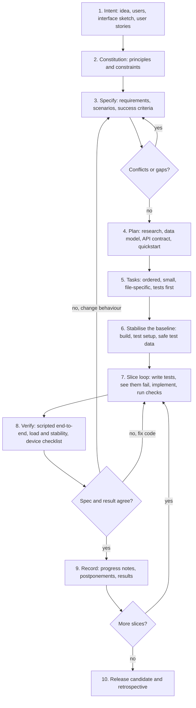

# Software Construction Course Project: "Bear Care"

| Student Name | Student ID | Role in the project | Contribution (%) |
|---|---|---|---|
| Saga Malmio | `[needs your input]` | `[confirm]` Specification writer, prompt engineer and implementer of the SDD build (Spec Kit, Claude Code and Copilot) | `[team to agree]` (git: 42 of 47 commits across all branches; commit counts are only an indication) |
| Julia Wentjärvi | `[needs your input]` | `[confirm]` Created the base project and the vibe-coded build (ChatGPT, Copilot) and the Atlas database | `[team to agree]` (git: 4 commits) |
| Eevi Nikkilä | 2303933 | `[needs your input: the template suggests CI/CD and verification, but the repository contains no CI pipeline and one commit by Eevi, the README on main]` | `[team to agree]` (git: 1 commit) |

> **How to read this draft.** Everything below was filled from sources that exist: the Git history, the Copilot chat history stored by VS Code (two sessions, 2026-10-09 and 2026-10-20/21), the project's specification files under `specs/001-bear-care-experience/`, and the Claude Code session in which the SDD build was completed (2026-10-23 to 2026-10-25). Places that only the team can answer are marked `[needs your input: ...]`. Numbers were measured, not estimated; the date of each measurement is given. Credentials and connection strings that appeared in the chats were deliberately left out.

---

## Executive summary

Care Bear is a cross-platform virtual-pet app that nudges people towards regular meals and movement. People log meals and steps, keep a streak, look after an animated bear, play Sudoku to earn points and spend them on treats, looks and backgrounds. It runs on Android, iPhone and in a web browser (Expo/React Native, TypeScript) against an Express and MongoDB Atlas API.

The same application was started twice: once by vibe coding (ChatGPT and Copilot, branch `branch1`) and once with Specification-Driven Development (branch `saga-sdd-coding`, then `review-baseline`). The SDD build used semi-formal specification: prioritised user stories with Given/When/Then acceptance scenarios, 70 numbered, testable functional requirements, 29 measurable success criteria, a data model, an API contract and executable quickstart validation scenarios. Specifications were produced and kept consistent with GitHub's Spec Kit (v1.2.3: constitution, specify, plan, tasks, implement), first through GitHub Copilot and later through Claude Code (Sonnet 5.5) using the same skills.

Verification followed the specification: tests were written first for each slice and were seen to fail before the code was written (158 server and 123 mobile automated tests, including database-backed ownership, concurrency and two-user isolation tests), then supplemented with a 25-user load test (1,499 requests, 0 failures, 95th percentile 173 ms), timing measurements, scripted browser walkthroughs against the real API and written manual device checklists. Findings from testing were fed back into the specification (for example the streak rule, reminders and timezone handling).

---

## 1. Introduction & Paradigm Shift

### 1.1 Project Overview & Objectives

This project explores two different approaches to AI-assisted software development: vibe coding and specification-driven development (SDD). The goal was to develop the same application with both approaches and compare them. The application is an interactive virtual pet that encourages users to build healthy daily habits by caring for a bear: meals and steps feed the bear's energy, a streak heart shows consistency, Sudoku and a reward shop make returning fun.

### 1.2 The Vibe Coding

Vibe coding means describing the wanted software to an AI agent in natural language, running what it produces and steering it with follow-up messages, with little or no written specification and no fixed workflow. Our vibe-coded build was done mainly by Julia with ChatGPT and GitHub Copilot: ChatGPT proposed the architecture and generated the backend classes, which were copied into a GitHub Codespace and debugged with pasted terminal errors (see 3.2). The result, branch `branch1`, grew quickly: by its last commit (2026-10-21, "frontend, and a bit of backend") it contained a backend with bear, meal, steps, energy and Sudoku routes and a mobile app with login, meals, steps, settings and a 685-line Sudoku screen. `[needs your input: Julia's account of how she worked and decided with ChatGPT]`

### 1.3 The SDD Methodology

Specification-Driven Development treats a written specification as the source of truth: requirements and acceptance criteria are written first, a plan and a task list are derived from them, tests are written from the criteria, and the AI implements one task slice at a time. Changes in behaviour are made in the specification first and then flow into plan, tasks, tests and code.

We used **Spec Kit** (GitHub's open-source SDD toolkit, version 1.2.3) because it gives a ready-made, ordered set of agent skills (constitution, specify, clarify, plan, tasks, analyze, implement), keeps every artefact in the repository as plain Markdown, and works with Copilot and with Claude Code. The constitution (`.specify/memory/constitution.md`) fixed eight principles for every AI change: simplicity, maintainability, consistency, security, testability, usability and reachability, minimal changes and backward compatibility.

**Scope and timeline** (from the Git history):

| Date | Event |
|---|---|
| 2026-09-21 / 10-09 | Repository created; base project and first backend (Julia) |
| 2026-10-09 | Copilot session: "finish the backend", first tests and build pass |
| 2026-10-15 | First SDD build on `saga-sdd-coding` (backend and Expo app from the "SDD Coding #1" prompt) |
| 2026-10-20/21 | Copilot sessions: comparing the vibe-coded and SDD branches, running the app, Expo Go and database connection problems; Julia pushes `branch1` with the frontend |
| 2026-10-23 | Spec Kit installed with the Copilot integration; constitution, specification, plan, research, data model, API contract, quickstart and 57 tasks created; stabilisation phases done |
| 2026-10-23 to 25 | Claude Code continues with the same Spec Kit skills: user stories 1 to 4 and phase 5 implemented slice by slice, committed and pushed to `review-baseline` |

**Workflow, both approaches**

```
Vibe coding:  idea -> prompt -> generated code -> run -> paste error -> prompt again -> ... (no written source of truth)
SDD:          constitution -> specify -> (clarify) -> plan -> tasks -> tests first -> implement slice -> verify -> update spec/tasks
```

---

## 2. Requirements & System Specification

### 2.1 Stakeholders

The primary stakeholders are the end users, the developers (us) and the owners of the application (us). There are no secondary stakeholders, because there are no sponsors, external vendors, partners or regulators, unless the app is actually released later. The end users are phone and computer users who want to build healthy habits. The app deliberately does not give medical advice (FR-033); the bear's "health" is playful feedback.

### 2.2 Functional Requirements

The specification (`specs/001-bear-care-experience/spec.md`) contains **70 functional requirements (FR-001 to FR-070)** grouped under four user stories (account and meals; reminders; caring for the bear and rewards; polish and honest settings), and **29 success criteria (SC-001 to SC-029)**. The table below keeps the team's original requirement list and records where each one stands on 2026-10-25.

| Name | Function | Priority | Status (2026-10-25) | Who is working on it? | Other notes |
|---|---|---|---|---|---|
| Calibration | User chooses how many times to commit to an action, e.g. eating a meal, and when to be reminded | High | **Done**: daily meal target (any whole number), step target, reminder times follow the target (one reminder per meal, 1 to 12) | Saga (SDD build) `[confirm]` | Reminder times default to a meal rhythm, e.g. 08:00, 12:30, 18:30 for three meals |
| Log | Logs all actions (meals, physical activity) | High | **Done**: meal log and activity/steps log, both private per user | Saga `[confirm]` | Times are entered in the device's timezone |
| Manual meal logging | Actions can be logged later in the logger | High | **Done**: date, hour and minute can be set to a past time | Saga `[confirm]` | Stored as an exact moment, shown in the device's timezone |
| Reminders | Notification at specified times | High | **Built but switched off**: local scheduled reminders with a "Log a meal" text action exist in code; the app says honestly that reminders are still being figured out | Saga `[confirm]` | Needs a development build to test properly; see `future_considerations.md` section 2 |
| Pet | Shows how the user is doing with mood and health; celebrates accomplishments | High | **Done**: animated SVG bear (tap reactions, blink, ear waves, bored moves, jump and hearts when fed), low-mood caption after two missed days, celebration caption when the goal is met | Saga `[confirm]` | Animations driven by named parts of the SVG |
| Statistics | Energy and food bars show how the pet feels | High | **Done**: DAILY GOAL bar, ENERGY bar (10 per meal, 5 per 1,000 steps, minus 5 per Sudoku start), STEPS line, rainbow streak heart with heartbeat | Saga `[confirm]` | Steps are typed by hand; reading them from a health app is planned (future considerations, section 7) |
| Desktop and mobile | Works on mobile phones and as a desktop/web app | High | **Done**: one Expo codebase for Android, iPhone and browser; the app finds the API on the computer serving it | Saga `[confirm]` | Verified in a desktop browser by script; phone checks are written but still to run |
| Mute toggle | Toggle a mute function | High | **Postponed**: there is no sound yet, so a mute switch would do nothing | | `future_considerations.md` section 6 |
| Game 1 | Sudoku; gives points used for fun things in the app | High | **Done**: generated puzzles with exactly one solution, muted digits, red clashes, win and incorrect results, one-time energy cost, reward points once per game | Saga `[confirm]`; an earlier Sudoku screen exists on Julia's `branch1` | |
| Log in | Email and password accounts | High (added) | **Done**, plus staying signed in until log out, log out, delete account, profile picture | Saga `[confirm]` | Password recovery postponed (needs a domain, DKIM and low spam rate) |
| Make-over | Edit the pet's appearance; unlock more with points | Optional | **Done**: bow tie, party hat, sunglasses, bought with reward points | Saga `[confirm]` | |
| Background and music | Themes with backgrounds and music | Optional | **Backgrounds done** (meadow, sunset, starry night, berry patch); **music postponed** | Saga `[confirm]` | |

### 2.3 Non-Functional Requirements

| Area | Requirement (measurable) | Result |
|---|---|---|
| Performance | Main screen usable within 3 s in at least 95% of launches (SC-013); feedback within 100 ms and transitions within 300 ms in at least 95% of cases (SC-014); at least 95% of ordinary API requests within 1 s at 25 concurrent users (SC-015/016) | Desktop browser, 2026-10-25: 20/20 launches within 3 s (median 0.56 s); 100/100 interactions within 100 ms (median 24 ms); 100/100 transitions within 300 ms (median 29 ms). API load test: 100% of 1,499 requests within 1 s, p95 173 ms, p99 205 ms. Phone measurements still to be taken. |
| Availability | The app must not present failed or uncertain requests as success (FR-045); with the server unreachable at launch the user stays signed in and gets a retry (FR-070); no unbounded memory growth in a 30-minute session (SC-017) | Implemented and tested; 30-minute session see 5.3 |
| Security | Authentication, authorisation and validation enforced by the backend (FR-044); each user's data private (FR-032, FR-050); stale concurrent edits detected, not overwritten (FR-051) | bcrypt password hashing, signed tokens, ownership checks on every record route, input validation with Zod, rate limiting on auth routes, Helmet headers, restricted CORS, secrets only in `.env` files (never committed), `npm audit` fixes (server 0 vulnerabilities; 5 remaining "high" findings are inside Expo's own CLI tool and have no patch) |
| Usability | First-time user can register, set a target and save a first meal within three minutes (SC-001); honest messages instead of pretending (reminders, password recovery, offline); one switch for bear animation; easy to find log out | Written as acceptance criteria; usability test with people `[needs your input: not run]` |
| Compatibility | Can be used as a web page (original requirement) | Yes: same code runs in a browser |
| Content | Backgrounds, clothing and animal make-over | Yes (shop); music postponed |

### 2.4 Technology Stack

- **App:** Expo SDK 58, React Native 0.88, React 19, TypeScript, `react-native-svg` (animated bear), `expo-secure-store`, `expo-image-picker` and `expo-image-manipulator` (profile picture), `expo-notifications` (present, switched off).
- **API:** Node.js, Express 5, TypeScript, Zod validation, Mongoose, MongoDB Atlas, bcryptjs, jsonwebtoken, helmet, express-rate-limit, optional Brevo/SMTP mailer (not in use).
- **Testing:** Vitest 5, Supertest, scripted browser runs with puppeteer-core and headless Edge, a load-test script.
- **AI generation and orchestration tools:** ChatGPT (initial backend, vibe coding), GitHub Copilot in VS Code agent mode (Auto model selection, backed by a Claude model) for repository work and the first Spec Kit setup, Spec Kit 1.2.3, Claude Code with Claude Sonnet 5.5 for the later SDD slices.

### 2.5 Interface & API Specifications

The complete contract is `specs/001-bear-care-experience/contracts/api-contract.md`. Errors always look like `{ "error": { "code", "message", "details?" } }`; protected routes need `Authorization: Bearer <token>`.

| Method | Path | Purpose |
|---|---|---|
| GET | `/health` | Service health |
| POST | `/api/auth/register`, `/api/auth/login` | Create an account; sign in |
| POST | `/api/auth/refresh` | Check a stored sign-in and get a fresh token |
| GET / DELETE | `/api/auth/me` | Read profile; delete the account and its records |
| GET / PATCH | `/api/profile` | Read and edit profile (meal and step targets, reminders, theme, look); edits carry field versions |
| GET / PUT / DELETE | `/api/profile/picture` | Optional profile picture |
| GET / POST | `/api/meals`, `/api/meals/:id` (GET, PATCH, DELETE) | Meal log |
| GET / POST | `/api/activities`; PATCH, DELETE `/api/activities/:id` | Steps and activity log |
| GET | `/api/progress` | Today's meals, steps, energy, streak, bear mood, seven-day history |
| POST | `/api/sudoku/games`, `/api/sudoku/games/:id/complete` | Start (costs 5 energy once) and complete (earns reward points once) |
| GET / POST | `/api/rewards`, `/api/rewards/unlock` | Reward balance and shop |
| POST | `/api/auth/password-reset/request`, `/confirm` | Built but disabled by default |

The user interface follows the original sketch: profile picture top right, energy and goal bars top left, the bear in the middle, the Sudoku paper on its right and the food bowl on its left, plus a reminder switch beside the profile icon.

### 2.6 How these requirements and specifications were created (using SDD AI tools)

1. The team's original list of functions, interface sketch and three user stories (see 4.5) were the input.
2. In Spec Kit the agent turned that description into a structured specification: three prioritised user stories with acceptance scenarios, edge cases, functional requirements, key entities, success criteria and assumptions; a quality checklist (`checklists/requirements.md`) was generated to check completeness.
3. `plan`, `research`, `data-model`, `contracts` and `quickstart` were generated from the specification, then `tasks.md` with dependency-ordered, file-specific tasks.
4. Later hands-on testing produced new requirements, which were added with the same workflow: for example "User Story 4" (everyday polish and honest settings: FR-062 to FR-069), then FR-070 (stay signed in), updated plan ("Increment 2") and tasks T063 to T089.

---

## 3. Vibe coding and your project

The vibe-coded build was done mainly with ChatGPT for the backend design and code, then GitHub Copilot for debugging and repository work. The project was split into backend (Express and MongoDB) and mobile app (Expo), written with separate prompts and combined by manually copying the generated classes into a GitHub Codespace. Copilot was also used on 2026-10-09 and 2026-10-20/21 as an agent that read the repository, ran commands and explained errors. No prompt book was used. `[needs your input: how the work was divided between Julia and Saga for this part]`

### 3.1 Prompting Framework

Plain natural-language prompts, iteratively refined; errors were pasted from the terminal back into the chat (a manual "error-feedback loop"). Copilot was used in agent mode (it plans, reads files, runs commands and edits). No chain-of-thought templates or custom system prompts were written; the AI's own plan was accepted or corrected conversationally.

### 3.2 Master Prompts / System Prompts

**ChatGPT prompts (Julia's vibe-coded start)**

1. *"Make the backend for a React Native application."* Purpose: get a starting architecture. Result: a Node backend with PostgreSQL chosen by the AI.
2. *"Change AI choice of database from PostgreSQL to MongoDB Atlas. All of the other choices of programs were familiar and therefore good."* Reasoning: the team knew MongoDB Atlas. The AI accepted the change.
3. *"It's supposed to be a game, where you can take care of a bear by tracking your own meals, health data (steps from local health app) and mini games. The games use energy which you can gain from logging meals… the user can choose how many meals a day they want to eat, and it can be changed in settings. You don't have to care about the mini games at this point. I only want the base and mainly the backend right now."* Expected: a clear class structure and rudimentary code. Result: a folder of classes that were inserted manually into the Codespace.
4. Debugging prompts: the TypeScript configuration conflicted with the way modules were imported; terminal errors were pasted into the chat.
5. MongoDB Atlas connection problems: errors were pasted again and again; Mongo turned out to be the hard part (compatibility and network access, not code).

**Copilot prompts (from the chat history)**

| # | Prompt (date) | Purpose and what happened |
|---|---|---|
| C1 | "Please finish the backend and any missing parts before we move onto front end and proper app functionality" (2026-10-09) | Expected a finished API. Copilot first mapped the workspace, found only a bare Expo starter, built an API slice with tests (7 tests, build passing) that did not need a database to run. |
| C2 | "pwsh command does not work. Is this because I haven't set up a server with Mongo?" / "can you run this without Powershell getting in the way so that this step doesn't repeat again" | Misdiagnosis by the user: the failing command was a PowerShell directory-switch problem, not MongoDB. Copilot switched to `npm --prefix` commands and fixed a generated `lint` script that pointed at the wrong command. Lesson: the prompt must say which environment the commands run in. |
| C3 | "Can you compare branches? … Branch 1 is vibecoded instead of sdd coded, but I want to know if that gives a difference in the quality of the code we have right now… Give me a list of differing objects and a note about how they are good or bad." (2026-10-20) | See 7.3: Copilot found concrete regressions in the SDD branch (meal deletion and meal-type validation removed, bear routes unmounted, fallback JWT secret) and good points (Zod validation). |
| C4 | "okay preserve a backup, then fetch the aforementioned branch. After that compare the files and keep relevant code according to the criteria of the app: SDD Coding #1 …" | A long prompt that combined a safety step (backup) with the app criteria; Copilot made the backup first. |
| C5 | "give me a list of which requirements this app now fulfills?" | Produced an implemented / partially implemented / not implemented list used for planning. |
| C6 | "Check why expo go app does not work with the database. It bundles on android then crashes … but not getting contact with the server on ios…" | Found an address and port mismatch between the app, the API and the phone (a phone needs the computer's network address, not `localhost`) and led to the `EXPO_PUBLIC_API_URL` setting. |
| C7 | "We changed to a private network and now mongodb does not connect." then "…is there a concrete fix through the terminal for the network I am on right now?" | Root cause: the phone network's resolver refused MongoDB's SRV lookup. Fix: an opt-in `MONGODB_DNS_SERVERS` setting so the API uses public DNS without changing Windows settings. |
| C8 | (screenshot of an error) "this is what it logs" | Copilot identified `ExpoTopicSubscriptionModule` as a native module missing from Expo Go, caused by `expo-notifications`. The same error returned later and was fixed properly (see 7.2). |

### 3.3 Prompt Iteration Log

| Initial prompt / specification | AI failure mode / bug produced | Refined prompt / specification | Resulting code quality | What did not happen according to plan | Modified prompt |
|---|---|---|---|---|---|
| ChatGPT: "Make the backend for a React Native application." | Chose PostgreSQL, which the team did not want | "Change … to MongoDB Atlas" | Backend structure usable | Database connection never worked smoothly (network access, TypeScript module settings) | Pasted terminal errors instead of describing the situation |
| Copilot: "Please finish the backend and any missing parts" | The agent could not know what "finished" meant; it built a generic account/meal/progress API | (later) the SDD prompt with full function list, interface and user stories | A tested slice, but not the team's product | The requested "missing parts" were never defined in the prompt | Replaced by the structured "SDD Coding #1" prompt (see 4.5) |
| "Check why expo go app does not work with the database" | Several symptoms mixed (Android crash vs iOS no contact) | Split into network address, database access and native module errors | Each cause found and fixed separately | The first reply assumed one cause | Asked for each platform's symptom separately |
| SDD build: "register and login with email and password" with no limits | Branch comparison: weaker password minimum (6), a fallback JWT secret `"secret"` | Constitution principle IV (Security) and spec requirements FR-044 and FR-002 | Secrets now only from environment; passwords at least 10 characters (72 bytes max); email normalised | None of this was in the first prompt; it appeared only when the spec made security a rule | Added "validate untrusted input" and "secrets only from configuration" as constitution rules |

---

## 4. Specification Driven Development

### 4.1 SDD Tool-kit

We used **Spec Kit** (GitHub, open source, version 1.2.3). It is easy to use, gives the agent a fixed set of skills in a fixed order (constitution, specify, clarify, plan, tasks, analyze, checklist, implement), stores everything as Markdown in the repository and connects to GitHub Copilot as well as to Claude Code.

### 4.2 Development Environment

- Windows 11 laptop, Visual Studio Code with GitHub Copilot Chat in agent mode (Auto model selection) for the early SDD work and repository operations.
- Claude Code in the terminal (Claude Sonnet 5.5) for the later SDD slices; it could run tests, scripts and a real browser (headless Edge) against the running app, which made test-first slices and end-to-end checks possible.
- Expo Go on phones and a desktop browser as the runtime; MongoDB Atlas for the database, with a separate `bear_buddy_test` database that automated tests are only allowed to use.
- Why: Copilot was already part of the course setup; Claude Code allowed longer autonomous slices with verification.

### 4.3 Deriving the requirements using the IDE/coding agents

- **Software requirements specification:** `spec.md` (user stories, requirements, edge cases, key entities, success criteria, assumptions).
- **System constraints:** `plan.md` ("Technical Context", "Constraints"): API must build and test independently of the Expo package; never assume `localhost` on a device; offline is read-only; Expo Go limits.
- **Interfaces:** `contracts/api-contract.md` and `data-model.md`.
- **Acceptance criteria:** Given/When/Then scenarios per user story and 29 measurable success criteria; `quickstart.md` turns them into runnable validation scenarios with recorded results.
- **Compliance:** the constitution (eight principles) and the rule that the app never presents meal targets, energy or bear health as medical advice (FR-033).

### 4.4 SDD Workflow and Implementation

1. **Constitution** (principles) then **specify** (what and why, no implementation details) then **plan** (technical context, research, design) then **tasks** (ordered, file-specific, tests first).
2. **Stabilise first:** phases 1 and 2 repaired the existing baseline (API build and test configuration, safe test database, two-user isolation tests, network failure tests) before any new feature.
3. **Implement in slices** of three to six related tasks per user story: write tests, see them fail, implement, run tests and typecheck, update the task list and record results in `quickstart.md`.
4. **Feed discoveries back into the specification** before changing code (for example the streak rule decision, reminders and timezone, password recovery postponement), then regenerate plan and tasks (Spec Kit `specify`, `plan`, `tasks`).
5. **Record deliberate postponements** in `future_considerations.md` instead of leaving half-working features.

Status on 2026-10-25: 89 tasks, 77 done, 12 open (phone checks, reminder checks and the stability measurement; see 5.3).

### 4.5 Prompts

**Initial SDD prompt ("SDD Coding #1")**, which was the team's function list, interface description and three user stories (full text in the team's original prompt; summary here):

- *Functions:* register and login with email and password; profile stored in the database; a log of food information (time, meal name, notes); calibration (how many times to commit to an action, when to be reminded); manual and backdated meal logging; reminders; pet showing mood and health; statistics bars; desktop and mobile; mute toggle; Sudoku with points; make-over; backgrounds and music; "if meals have been skipped for two days the health bar goes down and the bear looks worse".
- *Interface:* profile icon top right, energy and health bars top left, small bear in the middle, Sudoku paper on its right, food bowl on its left; in the profile: picture, how often meals are suggested, settings.
- *User story 1* (works from home, forgets to eat): a notification allowed through Do Not Disturb, a text field inside the notification to enter "meatballs", the bear celebrates, a treat appears that can be dragged to the bear, energy fills according to the meals per day and allows two Sudoku games. *User story 2* (hectic job): a quick "remind" toggle next to the profile icon. *User story 3* (teenager who likes the game): returns a few times a day to play and give treats.
- Second prompt: *"settings - delete account"*.

**What it produced and what did not match.** The agent built accounts, a meal log, a goal bar, reminder times and account deletion (see Copilot's own status list, C5), but left the pet, Sudoku, rewards, appearance and interactive notifications out, and the branch comparison (C3) showed that it had also dropped meal deletion, bear routes and some validation from the earlier vibe-coded backend. The lesson: one big prompt gives a broad but uneven result; the written specification with a task list is what made the remaining work trackable.

**Representative prompts from the Spec Kit and Claude Code phase** (2026-10-23 to 25), with what they did:

| Prompt (shortened) | Purpose | Outcome and refinement |
|---|---|---|
| "update /speckit-specify with bear movements: … rightArm waves when the bear is clicked, or the eyebrows lift … blinks and one of the ears sporadically waves … when fed bear jumps and waves, hearts pop up" | Add behaviour to the specification before code | Became FR-056 to FR-061 and an animation engine; the animation was checked by rendering each pose headlessly. A later "choppy breathing on web" finding led to FR-062 and a redesign (per-part updates instead of redrawing the whole bear). |
| "look at the expo-notifications download and review possible issues. Then fix them together with npm audit fix. The goal is to get notifications to work on android and iphone." | Review and repair | Found a missing foreground handler, a silent Android channel, taps ignored, reminders wrongly blocked in Expo Go, no interactive action; added them. Later, the user postponed notification work, so the code was kept but switched off with a feature flag. |
| "fix the bugs" (meal saved: bear reaction and "log another meal" did not work; blinking and breathing look wrong on web) | Reproduce first, then fix | The AI reproduced the problem in a scripted browser: the app was calling an old IP address, the bear was recreated after the screen change and missed the "fed" signal, and web "reduce motion" settings paused the animations. Fixes plus a switch in settings. |
| "can you make both expo go and the web version pick up the address automatically so that it is enough to share internet to try it out" | Remove manual configuration | The app derives the API address from the host that serves it; CORS opened for the Expo web port in development only. |
| "[pasted list] settings: animate on/off; log out; automatic timezone; … daily goal bar does not work now; remove forgot password … add a funny quip" then `/speckit-specify`, `/speckit-plan`, `/speckit-tasks` | A full spec, plan and task round | User Story 4, FR-062 to FR-069, 22 new tasks; implemented tests-first. |
| "2 and next" (answering "which streak rule?") | Resolve a specification conflict the AI had flagged | The spec said a streak day needs both meal and step targets; literally implemented, users who do not track steps could never build a streak. Decision recorded: steps count only when a step target is set. |

---

## 5. Verification

### 5.1 V&V Strategy

- **Test-driven with AI.** For each slice the tests were written from the acceptance scenarios first and run to see them fail (for example the five new failures before the meal-target and timezone fixes), then the code was written until they passed. Tests that need the database run against a separate `bear_buddy_test` database; a helper refuses any other database name.
- **Unit tests:** pure logic such as energy arithmetic, reminder schedules, Sudoku rules, streak and bear-health rules, time-zone conversion, animation engine, copy texts.
- **Integration tests:** the full API with Supertest against a real MongoDB database: registration and login, ownership, activities, progress, rewards, Sudoku, refresh, reminders, concurrency.
- **Functional / end-to-end checks:** scripted headless-browser walkthroughs against the real running app and API (sign-up, logging a meal, steps, shop, Sudoku, log out, staying signed in, two sessions editing one account), each with a throw-away account deleted afterwards.
- **Requirement verification:** every task names its requirement; `quickstart.md` holds the validation scenarios and a dated record of every run.
- **Performance and stability:** load test, launch and interaction timing, 30-minute soak session with network failures injected (5.3).
- **User acceptance and device testing:** written manual checklists for phones (Increment 2 validation, staying signed in, reminders); `[needs your input: results once run on phones]`.
- **Compliance:** security checks (ownership isolation tests, validation boundaries, `npm audit`, no secrets in the repository) and the no-medical-advice rule.
- **Threats to validity:** the measurements ran on one laptop in a headless desktop browser against the development build, with no added network delay, and not on phones; AI-written tests can share the AI's misunderstanding of a requirement; the Sudoku solution is checked on the phone, not on the server; reminders and email could not be verified end to end.

### 5.2 Code Audit Log

| Issue found | Resolution |
|---|---|
| Server API could not build or run its tests: `server/tsconfig.json` extended an Expo-only configuration | Removed the inheritance; API tests, typecheck and build then ran independently |
| The SDD branch's backend used a fallback secret `"secret"` when `JWT_SECRET` was missing (found by Copilot's branch comparison) | Configuration now requires a secret of at least 32 characters; no fallback |
| Meal target limited to 1 to 8 in validation and in the UI | Removed the ceiling (any positive whole number) in server, model and UI |
| A request body over the limit returned 500 instead of 413 | Added a 413 response in the standard error format; only the picture upload has a larger, bounded limit |
| Stale API address in `mobile/.env` made registration and meal saving time out | App now finds the API from the host serving it; the saved override can be cleared in the app |
| `expo-notifications` threw `ExpoTopicSubscriptionModule` missing in Expo Go | Notification code is never loaded while reminders are postponed (feature flag), covered by a test |
| Reminders and animations silently stopped when the device asked for reduced motion | One explicit "Animate the bear" switch (on by default) |
| Dependency vulnerabilities (critical `tinypool` via Vitest and others) | `npm audit fix` and Vitest 5 on both packages; server 0 vulnerabilities, 5 high findings remain inside Expo's own CLI (no patch exists) |
| Two sessions could overwrite each other's edits | Field-level version checks; first edit wins, stale edit gets a 409 with the latest values |
| A forgotten-password route exposed an endpoint that could not deliver mail | Routes disabled by default (`PASSWORD_RESET_ENABLED`), feature postponed and documented |
| Streak rule in the spec would block people who do not track steps | Rule changed and recorded in the spec before coding |

### 5.3 Test Execution Results

Measured on 2026-10-25 on one Windows laptop (details and limits in `quickstart.md`).

| Check | Result |
|---|---|
| Server automated tests | **158 passed** in 22 test files (database-backed tests against `bear_buddy_test`), typecheck and build pass |
| Mobile automated tests | **123 passed** in 23 test files, typecheck passes, `expo-doctor` 20 of 20 checks |
| Bundles | iOS, Android and web bundles compile |
| API load test (5 minutes, 25 users, 12 requests per minute each) | 1,499 requests, **0 failures**, all within 1 s; p50 44 ms, p95 173 ms, p99 205 ms, max 462 ms; **no cross-user data seen**, every created record stored exactly once |
| Launches, desktop browser, 20 runs | median 0.56 s, slowest 1.11 s, **20 of 20 within 3 s** |
| Interactions and transitions, 100 each | feedback median 24 ms, 100 of 100 within 100 ms; transitions median 29 ms, 100 of 100 within 300 ms |
| Breathing animation smoothness, 20 s sample | p99 frame time 26 ms, one frame over 33 ms, no long tasks |
| 30-minute stability session with slow and unavailable network phases | `[SOAK-RESULT: to be filled in]` |
| Phone checks (Expo Go on Android and iPhone), reminders, usability test | `[needs your input: not yet run; checklists are in quickstart.md]` |

---

## 6. Project Management & AI Toolchain Workflows

### 6.1 Version Control & Prompt Integration

- **Git commit conventions:** commits are made per completed slice and describe the specification change and the tasks they cover (for example "Field-level conflict detection for concurrent edits (FR-051, T055)", "Load test script and measurements (T050-T052)"). Task IDs (T001 to T089) and requirement IDs (FR-nnn) link code, tests and specification. Early commits (2026-10-15 to 10-21) were informal and not linked to prompts. Prompts themselves are not stored in the repository; this report is where they are collected.
- **Branches:** `main` (README), `branch1` (vibe-coded, Julia), `saga-sdd-coding` (first SDD build), `review-baseline` (Spec Kit-driven work, 14 commits to 2026-10-25).
- **Workspace configuration:** monorepo with `mobile/` (Expo app), `server/` (API) and `specs/` (Spec Kit artefacts); Spec Kit skills in `.github/skills` (Copilot) and `server/.claude/skills` (Claude Code); the constitution in `.specify/memory/constitution.md`; `.env` files for secrets are git-ignored with `.env.example` templates; tests refuse to run against any database that is not named `bear_buddy_test`.
- **Handling issues:** Windows PowerShell path and chaining problems (use `npm --prefix`), MongoDB network access and DNS on a mobile network (opt-in DNS servers), Expo Go limits (notifications), line-ending warnings. A progress file (`progress-notes.md`) and a postponement file (`future_considerations.md`) keep the state visible to every team member and to new AI sessions.

### 6.2 Team Contribution Breakdown

Human roles shifted from typing code to specifying, prompting, auditing and deciding.

- **Saga Malmio (Specifier / prompt engineer):** wrote the function list, interface and user stories; ran Spec Kit; made the product decisions (for example streak rule, postponing reminders, email and music, health-app plans); reviewed results and tested on devices. `[confirm and add details]`
- **Julia Wentjärvi (vibe-coding lead / database):** created the base project, the vibe-coded backend and frontend on `branch1`, and the Atlas database. `[confirm and add details]`
- **Eevi Nikkilä (verifier):** `[needs your input]` (the repository has one commit by Eevi and no CI pipeline).
- **The AI tools:** ChatGPT (initial backend), Copilot (repository work, comparison, environment debugging, Spec Kit setup), Claude Code (specification, planning and slice-by-slice implementation and verification).

---

## 7. Reflections on Specification-Driven Development

### 7.1 Benefits of AI-Assisted SDD

- **Everything had a place and a test.** 70 requirements and 29 success criteria meant "done" was checkable; 77 of 89 tasks closed, each with named files and a result recorded.
- **Faster to a *correct* feature, even if not to a first draft.** The vibe branch reached many screens quickly (its last commit adds roughly 2,700 lines of source code, including a 685-line Sudoku screen, on top of generated lock files), but the SDD build could show how each behaviour was verified (158 + 123 tests, a load test, scripted walkthroughs).
- **Decisions were visible.** When the AI found that the specification contradicted itself (streak rule, reminders versus Expo Go, offline writes versus idempotency), it asked before coding, and the answer went into the spec.
- **Safe change.** Because plan, tasks and tests existed, large later changes (automatic timezone, stay signed in, field-level conflicts) did not break earlier features.
- `[needs your input: a number for "how much faster than manual typing"; the team did not time a manual build]`

### 7.2 Core Bottlenecks and Challenges

- **AI drifting from the product intent.** The first one-shot SDD prompt produced a broad but uneven app (the comparison found removed meal deletion and bear routes). Fixed by splitting the work into specification, plan and small test-first slices.
- **Environment friction beat code problems.** Most lost time went to Expo Go and phone networking, MongoDB access on a mobile network, PowerShell quirks, ports already in use and secrets in `.env` files, not to application logic.
- **Specification gaps surfaced late.** The reminders requirement assumed notifications work in Expo Go; the streak requirement blocked users who do not track steps; password recovery needs a domain and email authentication. Fixed by updating the spec and recording postponements rather than shipping features that pretend to work.
- **Context and consistency.** A long session needs written state: `progress-notes.md`, `tasks.md` and the specification served as memory across sessions and agents (Copilot, then Claude Code).
- **Tests can be wrong too.** Browser scripts failed several times because of the script (stale element handles, background tabs), not the app; each failure had to be diagnosed before trusting either side.
- **Dependency hygiene.** Security audit findings could not all be fixed (remaining ones are inside Expo's CLI); the decision and reason were recorded.

### 7.3 Lessons Learned & Best Practices

Evidence-based comparison of vibe coding and SDD in this project:

| Aspect | Vibe coding (`branch1`) | SDD (Spec Kit) |
|---|---|---|
| Speed to visible features | Very fast (frontend, steps, energy and Sudoku appeared in one commit) | Slower at first (specification, plan, stabilisation first) |
| Knowing what is done | Hard: the status list had to be asked for afterwards | Direct: task list and requirement IDs |
| Quality findings | Copilot's comparison rated the vibe backend as more complete (bear routes, meal deletion, meal-type validation) | The SDD branch had better validation structure (Zod) but dropped features; later fixed through the spec and tests |
| Security | Not specified; secrets and validation depended on what the AI chose | Constitution and requirements made security explicit and testable |
| Change over time | Each prompt risked overwriting earlier behaviour | Tests and tasks caught regressions (for example, the existing progress test when the summary shape changed) |

Best practices that worked, with examples:

1. **Write failing tests first and watch them fail** (five new failures before the first US1 fixes proved the tests could catch the bugs).
2. **Reproduce before fixing** (the "meal saved" bug had two unrelated causes that only a scripted run revealed).
3. **Make the AI ask when the specification conflicts with usability** (streak rule).
4. **Do not let a feature pretend to work**: switch it off and say so (reminders, password recovery, mute).
5. **Keep a postponement log** with reasons and the code locations so nothing is lost.
6. **Keep secrets and test data separate**: a test database name check protects real data.
7. **Measure and record limits honestly**: say what was measured on which machine.

`[needs your input: personal conclusion on how the experience changed your understanding of software construction]`

### 7.4 Proposed Specification-Driven Development Workflow



| Phase | Objective | Inputs | Outputs | AI role | Human oversight |
|---|---|---|---|---|---|
| 1 Intent | Capture what and for whom | Ideas, sketches, user stories | A short description | Brainstorm, reword | Owns the product intent |
| 2 Constitution | Fix rules for every change | Team values, course constraints | Principles file | Draft | Approve |
| 3 Specify | Testable requirements | Intent, constitution | spec with scenarios and success criteria | Write, check completeness, ask at most a few questions | Decide the questions, accept scope |
| 4 Plan | Design before code | Spec | plan, research, data model, contracts, quickstart | Draft and compare options | Check feasibility |
| 5 Tasks | Small ordered work | Plan | tasks with files and tests | Generate | Check order and size |
| 6 Stabilise | Make the baseline trustworthy | Existing code | Passing build, tests, safe test data | Fix configuration | Review |
| 7 Slice loop | Build in verified steps | Tasks | Code, tests, updated tasks | Write tests, then code (vibe-style speed inside a boundary) | Review diffs; do not skip failing-first |
| 8 Verify | Prove the specification holds | Running system | Measurements, walkthrough results | Run scripts, collect numbers | Run device checks, judge usability |
| 9 Record | Keep state | All results | Progress notes, postponement log | Summarise | Confirm decisions |
| 10 Retrospective | Learn | Everything | Lessons, next steps | Draft | Reflect |

**Where AI helps most:** drafting specifications, generating tests from scenarios, boilerplate, scripted verification, record keeping. **Where humans stay essential:** product intent and priorities, resolving specification conflicts, security and privacy judgements, device and usability testing, deciding what to postpone. **Why this workflow:** in this project vibe coding gave speed without a way to know what was finished, and one-shot SDD prompts still drifted; the combination of a written specification, small test-first slices and honest records is what let work continue across sessions and agents without regressions.

---

### Appendix: sources used for this draft

- Git history of all branches (`git log`, `git shortlog`).
- Copilot Chat history stored by VS Code for this workspace: session of 2026-10-09 (4 requests) and session of 2026-10-20/21 (25 requests).
- `specs/001-bear-care-experience/` (spec, plan, research, data model, contract, quickstart, tasks, progress notes, future considerations).
- The Claude Code session of 2026-10-23 to 25 (prompts and results summarised above).
